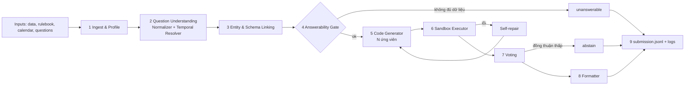

# 01. Kiến trúc tổng thể

## Luồng chính

## Nguyên tắc thiết kế
1. **Code là nguồn chân lý**: mọi con số do SQL/Python tính ra, LLM chỉ viết code.
2. **Rule-based trước, LLM sau**: ngày tháng, làm tròn, chuẩn hóa chuỗi, bỏ phiếu đều là code thuần để đảm bảo tái lập.
3. **Fail-safe**: lỗi ở bất kỳ câu nào → abstain + ghi log, không làm sập cả lượt chạy.
4. **Ghi dần**: kết quả ghi ngay từng câu; hết giờ vẫn giữ được phần đã làm.
5. **Tái lập**: seed cố định, temperature 0, sắp xếp ổn định, bỏ phiếu theo kết quả thực thi.
6. **Tổng quát**: không phụ thuộc loại hình kinh doanh; tri thức nghiệp vụ lấy từ rulebook và README.

## Các thành phần và dữ liệu trao đổi
| Bước | Vào | Ra |
|---|---|---|
| Ingest | file dữ liệu, README, rulebook, calendar | `BusinessContext` (views DuckDB, profile, luật) |
| Understanding | câu hỏi gốc, as_of_date, rulebook | `ResolvedQuestion` (câu chuẩn, khoảng thời gian, ý định) |
| Linking | `ResolvedQuestion`, profile | `LinkResult` (thực thể, bảng/cột, cờ mơ hồ/thiếu) |
| Gate | `LinkResult`, profile | quyết định: tiếp tục / unanswerable (kèm lý do) |
| CodeGen | tất cả ngữ cảnh | N đoạn code (SQL/Python) |
| Execution | code | kết quả hoặc lỗi (+ vòng sửa) |
| Voting | N kết quả | kết quả thắng + độ tin cậy |
| Formatter | kết quả thắng | `{id, type, answer}` đúng chuẩn |

## Sơ đồ module
Xem cây thư mục trong `AGENTS.md` mục 5. Mỗi bước tương ứng một package trong `src/datamate/`.
